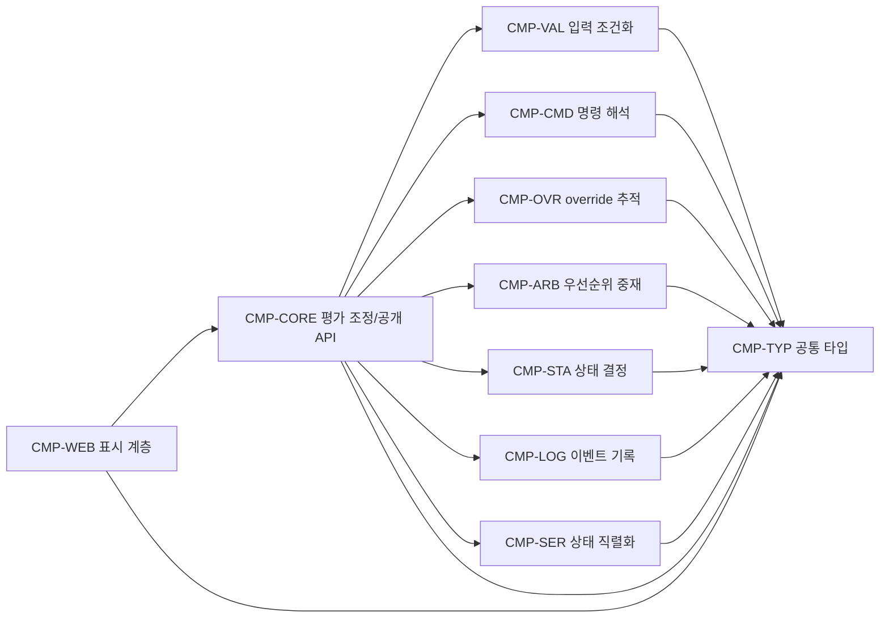
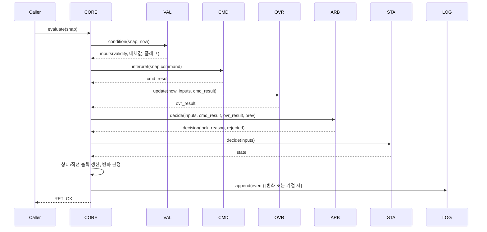

# 소프트웨어 아키텍처 설계 (SWE.2) — 전자식 차일드락 제어 SW

| 항목 | 값 |
|---|---|
| 문서 ID / 버전 | SAD-ECL-001 / 0.1 (Draft) |
| 입력 | `docs/SRS.md` v0.3, `docs/safety-requirements.md` v0.3, `docs/open-issues.md` |
| 스킬 | `architecture-design` |
| 리뷰 상태 | 미리뷰 (DEC-008: 이터레이션 종료 시 통합 리뷰) |
| 범위 | 제어 코어와 표시 계층 전체 구조. 구현은 이터레이션 단위(이터레이션 1: 코어 전체, 이터레이션 3: 표시 계층) |

경계 문구: 교육용 가상 OEM 입력에 기반하며 준수·인증·ASIL 달성을 주장하지 않는다.

## 1. 설계 개요와 결정

**목표**: 입력 조건화 → 명령 해석 → override 추적 → 우선순위 중재 → state 결정 → 기록/직렬화의 단방향 데이터 흐름을 가진 동기식 제어 코어. 전역 변수 없이 컨텍스트(`ecl_core_t`)를 호출자가 소유하며 모든 시각은 호출자가 주입한다(SRQ-CON-002, 005). 한 번의 평가는 고정 크기 연산만 수행한다(동적 할당 없음, 최악 시간 O(1)).

| 결정 | 선택 | 검토한 대안와 사유 |
|---|---|---|
| 중재 로직 구조 | 상태 없는 순수 함수형 `ecl_arb_decide()` + 상태는 입력으로 전달 | 상태를 중재기 내부에 보유: 시험·결정론(SRQ-QUA-FUN-001)이 어려워 기각 |
| 컴포넌트 상태 보관 | 컴포넌트별 컨텍스트 구조체를 `ecl_core_t`가 소유, 각 컴포넌트는 포인터로만 접근 | 전역 정적 변수: 인스턴스 다중화·시험 격리 불가, 아키텍처 규칙 3 위반으로 기각 |
| 구조체 공개 | 컨텍스트 구조체는 헤더에 정의하되 "private" 필드를 두고 접근 함수로만 사용(INS로 검사) | 불투명 핸들 + 동적 할당: 동적 할당 금지 정책과 충돌. 불투명 핸들 + 정적 풀: 복잡도 대비 이득 작음 |
| 입력 표현 | 정수 센티널 `ECL_ABSENT`(= `INT_MIN`)로 누락, `NaN`으로 속도 누락 | 별도 present 플래그 구조체: 필드 수 2배, 호출자 부담 증가 |
| 틱 호출 | 스냅샷 없는 평가는 별도 함수 `ecl_core_tick()` | 스냅샷 NULL 허용: SRQ-QUA-REL-001(NULL 인자는 `RET_ERR_NULL`)과 충돌 |
| 표시 계층 | 별도 컴포넌트 `CMP-WEB`가 코어 공개 API만 호출 (이터레이션 3 상세화) | 코어에 HTTP 포함: 책임 혼합, 기각 |

## 2. 컴포넌트 구조



의존은 위 그림의 방향뿐이며 순환이 없다(`TYP`는 말단, `CORE`는 `TYP`와 각 기능 컴포넌트에 의존, 기능 컴포넌트 간 직접 의존 없음 → 결합도 낮음). `CORE`만 상태를 가진 컴포넌트들을 조합한다.

## 3. 컴포넌트 명세

| 컴포넌트 | 책임(한 문장) | 상태 보유 | 소스 위치 |
|---|---|---|---|
| CMP-TYP | 컴포넌트가 공유하는 열거형·구조체·오류코드·상수를 정의한다. | 없음 | `include/ecl_types.h` |
| CMP-VAL | 스냅샷의 형식·범위·freshness를 검사하고 INVALID/STALE 입력을 안전 측 대체 값으로 치환하며 PENDING 지속 시간을 추적하여 조건화된 입력을 만든다. | 있음(마지막 수신 시각, PENDING 시작 시각) | `src/ecl_val.c`, `include/ecl_val.h` |
| CMP-CMD | 운전자 명령의 형식을 검사하여 수락/거절과 해석된 명령을 만든다. | 없음 | `src/ecl_cmd.c`, `include/ecl_cmd.h` |
| CMP-OVR | 접근위험 도어별 해제 억제 시각을 기록·삭제하고 override 여부를 판정한다. | 있음(도어별 첫 억제 시각, override 상태) | `src/ecl_ovr.c`, `include/ecl_ovr.h` |
| CMP-ARB | 도어별로 우선순위 규칙(P1~P11)을 적용하여 출력과 이유코드를 결정한다. | 없음 | `src/ecl_arb.c`, `include/ecl_arb.h` |
| CMP-STA | 조건표에 따라 state(OFF/NORMAL/DEGRADED/FAULT)를 결정한다. | 없음 | `src/ecl_sta.c`, `include/ecl_sta.h` |
| CMP-LOG | 이벤트를 고정 크기 순환 버퍼에 기록·조회하고 이벤트 ID를 부여한다. | 있음(순환 버퍼, ID 카운터) | `src/ecl_log.c`, `include/ecl_log.h` |
| CMP-SER | 상태를 `필드=값;` ASCII로 직렬화한다. | 없음 | `src/ecl_ser.c`, `include/ecl_ser.h` |
| CMP-CORE | 위 컴포넌트를 순서대로 호출하여 평가 1회를 수행하고 공개 API(초기화, 평가, 틱, 상태 조회, 직렬화, 이벤트 조회)를 제공한다. | 있음(직전 확정 출력, 직전 평가 결과, 하위 컨텍스트 소유) | `src/ecl_core.c`, `include/ecl_core.h` |
| CMP-WEB | 코어 공개 API를 호출하여 HTML 상태 화면과 명령 입력을 제공하고 직렬화 오류를 HTTP 500으로 응답한다. (이터레이션 3) | 없음 | `src/web/` (이터레이션 3 상세화) |

## 4. 인터페이스 명세

공통 규칙: 모든 함수는 `ecl_ret_t`(`RET_OK`=0, `RET_ERR_NULL`=-1, `RET_ERR_SERIALIZE`=-2)를 반환하고 NULL 포인터 인자에 `RET_ERR_NULL`을 반환한다(SRQ-QUA-REL-001). 반환 `RET_ERR_NULL` 시 출력 인자는 변경하지 않는다. 시각은 초(s, `double`), 속도 km/h. 스레드 안전성: 컨텍스트 단위로 단일 스레드 전용(같은 컨텍스트의 동시 호출 금지, 서로 다른 컨텍스트는 독립). 모든 입력 enum의 범위 밖 값과 누락은 오류코드가 아니라 INVALID 판정으로 처리한다(SSR-005).

### 4.1 CMP-TYP (공통 타입, 헤더 전용)

| 항목 | 정의 |
|---|---|
| 오류코드 | `ecl_ret_t`: `RET_OK=0`, `RET_ERR_NULL=-1`, `RET_ERR_SERIALIZE=-2` |
| 센티널 | `ECL_ABSENT` = `INT_MIN`(정수 누락), 속도 누락은 `NaN` |
| 열거형 | `ecl_lock_t`{`ECL_RELEASE`=0,`ECL_LOCK`=1}, `ecl_state_t`{OFF,NORMAL,DEGRADED,FAULT}, `ecl_validity_t`{VALID,INVALID,STALE}, `ecl_crash_t`{NONE,PENDING,CONFIRMED}, `ecl_gear_t`{P,N,D,R}, `ecl_side_t`{LEFT,RIGHT,ALL}, `ecl_action_t`{LOCK_CMD,UNLOCK_CMD}, `ecl_source_t`{PHYSICAL_BUTTON,AVN,VOICE,MOBILE_APP}, `ecl_reason_t`(SRS 부록 A의 RC_* 0~18), `ecl_door_t`{LEFT_DOOR=0,RIGHT_DOOR=1}, `ecl_signal_t`(입력 13종 인덱스: SPEED, GEAR, SRC_TS, CRASH, APPROACH_L/R, FIRE, OVERTEMP, ADULT, ISOFIX_L/R, IGNITION, FAULT) |
| 구조체 | `ecl_command_t`{present, side, action, source}, `ecl_snapshot_t`{timestamp_s, source_timestamp_s, vehicle_speed_kph, gear, crash_status, rear_left/right_approach_risk, fire_detected, overtemperature_detected, adult_present, isofix_left/right, ignition_on, sensor_fault, command}, `ecl_status_t`{lock[2], state, reason_code, validity[13], override[2], command_rejected}, `ecl_event_t`{event_id(uint64), timestamp_s, lock[2], state, reason_code, command_rejected, validity[13]} |
| 상수 | `ECL_EVENT_CAPACITY`=100, `ECL_STALE_LIMIT_S`=0.200, `ECL_PENDING_LIMIT_S`=1.0, `ECL_OVERRIDE_WINDOW_S`=10.0, `ECL_SPEED_MOVING_KPH`=3.0, `ECL_SPEED_MAX_KPH`=300.0 |

### 4.2 CMP-VAL

```c
ecl_ret_t ecl_val_init(ecl_val_t *val);
ecl_ret_t ecl_val_condition(ecl_val_t *val, const ecl_snapshot_t *snap, ecl_inputs_t *out);
ecl_ret_t ecl_val_condition_tick(ecl_val_t *val, double now_s, ecl_inputs_t *out);
```
| 항목 | 내용 |
|---|---|
| 제공 | 위 3개 함수 |
| 요구 | 없음(`ecl_types.h`만 사용) |
| `ecl_inputs_t` 출력 | 입력 13종의 `validity[]`, 대체 후 유효 값(`speed_moving`, `crash`, `approach[2]`, `isofix[2]`, `fire`, `overtemp`, `adult`, `ignition_on`, `sensor_fault`), `stale`(STALE 판정 여부), `substituted`(SSR-020~025, 029로 대체된 입력 존재), `hold_reason`(P2~P4 유지 조건의 이유코드), `pending_timeout_first`(1.0 s 초과를 처음 판정한 평가), `command`(원 명령 복사) |
| 사전 조건 | `ecl_val_init` 호출 후. `now_s`는 단조 비감소(감소 시 마지막 수신 시각 대비 음수 간격은 0으로 간주) |
| 사후 조건 | `RET_OK`이면 `out`이 모든 필드로 채워진다. `ecl_val_condition`은 `snap->timestamp_s`를 평가 시각으로 사용한다 |
| 타이밍 | O(1) |
| 오류 | NULL → `RET_ERR_NULL` |

### 4.3 CMP-CMD

```c
ecl_ret_t ecl_cmd_interpret(const ecl_command_t *raw, ecl_cmd_result_t *out);
```
| 항목 | 내용 |
|---|---|
| `ecl_cmd_result_t` | `present`(명령 존재), `rejected`(거절), `valid`(유효한 명령), `side`, `action`, `source`(유효할 때) |
| 사후 조건 | `raw->present`가 FALSE이면 `present=0`. 하나라도 누락/형식 오류/미등록이면 `rejected=1`, `valid=0`(SRQ-FUN-007). 그 외 `valid=1` |
| 오류 | NULL → `RET_ERR_NULL`. 순수 함수(상태 없음) |

### 4.4 CMP-OVR

```c
ecl_ret_t ecl_ovr_init(ecl_ovr_t *ovr);
ecl_ret_t ecl_ovr_update(ecl_ovr_t *ovr, double now_s, const ecl_inputs_t *in, const ecl_cmd_result_t *cmd, ecl_ovr_result_t *out);
```
| 항목 | 내용 |
|---|---|
| `ecl_ovr_result_t` | `suppress[2]`(도어별 해제 억제 대상), `override[2]`(override 상태), `ack[2]`(이번 평가에서 도어별 override 판정) |
| 동작 | 접근위험 TRUE인 도어에 유효한 unlock 명령이 오면 해제를 억제하고, 첫 억제 시각이 없으면 기록한다. 같은 도어·같은 source의 unlock이 첫 억제 시각부터 ≤ 10.0 s이면 override로 판정한다. 접근위험이 FALSE가 되면 기록 삭제, override 상태는 해소 또는 10.0 s 초과 시 FALSE(SRQ-FUN-034). 10.0 s 초과 재입력은 새 첫 억제 시각을 기록(SRQ-FUN-035) |
| 사전/사후 | `ecl_ovr_init` 후. 사후: `out`이 채워진다 |
| 오류 | NULL → `RET_ERR_NULL` |

### 4.5 CMP-ARB

```c
ecl_ret_t ecl_arb_decide(const ecl_inputs_t *in, const ecl_cmd_result_t *cmd, const ecl_ovr_result_t *ovr,
                         const ecl_lock_t prev[2], ecl_decision_t *out);
```
| 항목 | 내용 |
|---|---|
| `ecl_decision_t` | `lock[2]`, `reason_code`, `command_rejected` |
| 동작 | SSR-027 우선순위 표 P1~P11을 도어별로 적용한다. P2~P4의 "유지"는 `prev`를 쓰되 접근위험 도어는 LOCK. 이유코드는 출력을 선택한 규칙의 코드(SRS 부록 A) |
| 사전/사후 | `prev` 원소는 `ECL_RELEASE` 또는 `ECL_LOCK`. 사후: `lock[]`이 두 값 중 하나(SRQ-FUN-021) |
| 오류 | NULL → `RET_ERR_NULL`. 순수 함수(결정론) |

### 4.6 CMP-STA

```c
ecl_ret_t ecl_sta_decide(const ecl_inputs_t *in, ecl_state_t *out);
```
조건표(SSR-030): FAULT > DEGRADED > OFF > NORMAL, 이전 상태 무관. 순수 함수. NULL → `RET_ERR_NULL`.

### 4.7 CMP-LOG

```c
ecl_ret_t ecl_log_init(ecl_log_t *log);
ecl_ret_t ecl_log_append(ecl_log_t *log, const ecl_event_t *event_without_id, uint64_t *assigned_id);
ecl_ret_t ecl_log_query(const ecl_log_t *log, ecl_event_t *out, size_t capacity, size_t *count);
ecl_ret_t ecl_log_test_set_counter(ecl_log_t *log, uint64_t value);  /* 시험 빌드 전용(ECL_TEST_BUILD), SRQ-FUN-039 */
```
`append`: ID를 1부터 1씩 증가시켜 부여, 용량 100 초과 시 가장 오래된 것 삭제, ID가 `UINT64_MAX`인 이벤트 기록 후에는 새 이벤트를 기록하지 않고 `assigned_id`를 0으로 설정(SRQ-FUN-037). `query`: 최신 최대 100건을 ID 오름차순으로 복사, `count`에 건수. `capacity`가 보존 건수보다 작으면 최신 `capacity`건. NULL → `RET_ERR_NULL`.

### 4.8 CMP-SER

```c
ecl_ret_t ecl_ser_status(const ecl_status_t *status, char *buf, size_t capacity, size_t *length);
```
형식: `lock_left=LOCK;lock_right=RELEASE;state=NORMAL;reason_code=RC_NONE;override_left=0;override_right=0;command_rejected=0;validity_speed=VALID;...;validity_sensor_fault=VALID;` (필드 순서는 상세 설계 §3.7이 정의하며 이 문서는 형식 예만 둔다). `capacity`가 필요 길이+1보다 작으면 `RET_ERR_SERIALIZE`(버퍼 변경 안 함). NULL → `RET_ERR_NULL`. 순수 함수.

### 4.9 CMP-CORE (공개 API)

```c
ecl_ret_t ecl_core_init(ecl_core_t *core);
ecl_ret_t ecl_core_evaluate(ecl_core_t *core, const ecl_snapshot_t *snap);
ecl_ret_t ecl_core_tick(ecl_core_t *core, double now_s);
ecl_ret_t ecl_core_get_status(const ecl_core_t *core, ecl_status_t *out);
ecl_ret_t ecl_core_serialize_status(const ecl_core_t *core, char *buf, size_t capacity, size_t *length);
ecl_ret_t ecl_core_query_events(const ecl_core_t *core, ecl_event_t *out, size_t capacity, size_t *count);
```
| 항목 | 내용 |
|---|---|
| 호출 순서 | `ecl_core_init` → (`ecl_core_evaluate` \| `ecl_core_tick`)* ; 조회 함수는 init 후 언제든 가능 |
| 사전 조건 | 평가 간격 0.010 s(호출 계약, SRQ-LIM-002). `init` 전 호출은 정의되지 않음 |
| 사후 조건 | `RET_OK`이면 같은 호출 반환 시점에 출력·state·reason_code·이벤트가 확정(SRQ-FUN 평가 의미) |
| 초기 상태 | lock = RELEASE/RELEASE, state = OFF, reason = RC_NONE, 이벤트 0건(SRQ-FUN-026, 036) |
| 오류 | NULL → `RET_ERR_NULL`. 직렬화 버퍼 부족 → `RET_ERR_SERIALIZE` |
| `ecl_core_t` | 하위 컨텍스트(`ecl_val_t`, `ecl_ovr_t`, `ecl_log_t`), 직전 확정 출력, 직전 평가 결과(이벤트 변화 판정 기준), 마지막 `ecl_status_t`를 소유(private 필드) |

### 4.10 CMP-WEB (이터레이션 3에서 상세화)
요구 인터페이스: `ecl_core_*` 공개 API만 사용. 제공 인터페이스: HTTP `GET /status`(상태 화면), `POST /command`, `POST /snapshot`(시험 입력). 직렬화 실패(`RET_ERR_SERIALIZE`) → HTTP 500. HTML은 C 코드로 생성하고 클라이언트 스크립트를 쓰지 않는다(SRQ-CON-009).

## 5. 동적 거동

**평가 시퀀스**(`ecl_core_evaluate`):



`ecl_core_tick`는 VAL의 `condition_tick`으로 시작하고 명령은 없는 것으로 같은 순서를 따른다.

**상태 전이**(SSR-030, 이전 상태 무관): FAULT(sensor_fault TRUE/INVALID) > DEGRADED(STALE 또는 INVALID 대체) > OFF(ignition 유효 FALSE) > NORMAL.

**타이밍/자원**: 평가 1회 < 0.010 s(SRQ-LIM-004). 정적 메모리: 이벤트 100건 × `sizeof(ecl_event_t)`(약 100 B) ≈ 10 KB와 컨텍스트 수 KB. 동적 할당과 재귀 없음.

## 6. 설계 원칙 점검

| 원칙 | 적용 |
|---|---|
| SRP | 컴포넌트마다 변경 이유 하나(검증 규칙, 명령 문법, override 정책, 중재 순서, state 조건, 이력, 직렬화 형식) |
| OCP | 새 입력 규칙은 `CMP-VAL`과 `CMP-ARB` 규칙 추가로 확장, 호출자 API 불변 |
| LSP/ISP | 컴포넌트 인터페이스는 용도별 함수로 분리(조회/평가/직렬화) |
| DIP | `CORE`는 컴포넌트 공개 헤더(인터페이스)에만 의존, 컴포넌트 간 의존 없음 |
| 캡슐화 | 컴포넌트 내부 함수는 `static`, 공개 헤더에는 인터페이스와 컨텍스트 타입만 노출. 전역 변수 없음 |

## 7. 요구사항 ↔ 컴포넌트 할당

(모든 SRQ/SSR을 정확히 하나 이상의 컴포넌트에 할당했다. 횡단 제약은 "전체"로 표기하고 INS/BLD로 검증한다.)

| 컴포넌트 | 할당 요구사항 |
|---|---|
| CMP-TYP | SRQ-CON-003, SRQ-CON-006, SRQ-CON-007 (이벤트·입력 구조체에 금지 필드 없음), SRQ-FUN-029 (이벤트 필드 정의), SRQ-FUN-022 (상태 필드 정의) |
| CMP-VAL | SSR-005, SSR-006, SSR-007, SSR-008, SSR-020, SSR-021, SSR-022, SSR-023, SSR-025, SSR-029, SSR-032, SSR-004(PENDING 지속), SSR-031(타임아웃 첫 판정 플래그), SSR-034(조건 해소 판정) |
| CMP-CMD | SRQ-FUN-001, SRQ-FUN-007, SRQ-FUN-031(거절 명령 비반영의 입력 측), SRQ-FUN-008 |
| CMP-OVR | SRQ-FUN-017, SRQ-FUN-019, SRQ-FUN-020, SRQ-FUN-033(override_ack 제공), SRQ-FUN-034, SRQ-FUN-035, SSR-015, SSR-035 |
| CMP-ARB | SSR-001, SSR-002, SSR-003, SSR-009(유지·reason 측면은 STA와 분담: 유지는 ARB), SSR-010, SSR-011, SSR-012, SSR-013, SSR-014, SSR-016, SSR-017, SSR-019, SSR-024, SSR-027, SSR-033, SSR-036, SSR-037, SSR-021(ISOFIX 대체값의 LOCK 반영), SSR-026(대체 입력 플래그 사용), SRQ-FUN-002, SRQ-FUN-003, SRQ-FUN-004, SRQ-FUN-005, SRQ-FUN-006, SRQ-FUN-009, SRQ-FUN-010, SRQ-FUN-011, SRQ-FUN-012, SRQ-FUN-013, SRQ-FUN-014, SRQ-FUN-016, SRQ-FUN-018, SRQ-FUN-021, SRQ-FUN-032, SRQ-FUN-038 |
| CMP-STA | SSR-018, SSR-026, SSR-028, SSR-030, SRQ-FUN-015, SRQ-FUN-036(초기 state는 CORE가 초기화, 규칙은 STA) |
| CMP-LOG | SRQ-FUN-027, SRQ-FUN-028, SRQ-FUN-030, SRQ-FUN-037, SRQ-FUN-039, SRQ-LIM-001, SRQ-LIM-003 |
| CMP-SER | SRQ-FUN-023, SRQ-QUA-FUN-001(직렬화 형식) |
| CMP-CORE | SRQ-FUN-021(출력 확정), SRQ-FUN-022(상태 조회), SRQ-FUN-026, SRQ-FUN-036(초기 상태), SRQ-QUA-REL-001, SRQ-QUA-FUN-001(결정론), SRQ-LIM-002, SRQ-LIM-004, SRQ-CON-002, SRQ-CON-004, SRQ-CON-005, SSR-008(틱 호출 제공) |
| CMP-WEB | SRQ-FUN-024, SRQ-FUN-025, SRQ-CON-008, SRQ-CON-009 |
| 전체(횡단) | SRQ-CON-001 (C11) |

SSR-009(STALE 판정 시 state=DEGRADED)는 상태 결정이므로 CMP-STA에도 할당한다: CMP-STA = SSR-009 추가.
